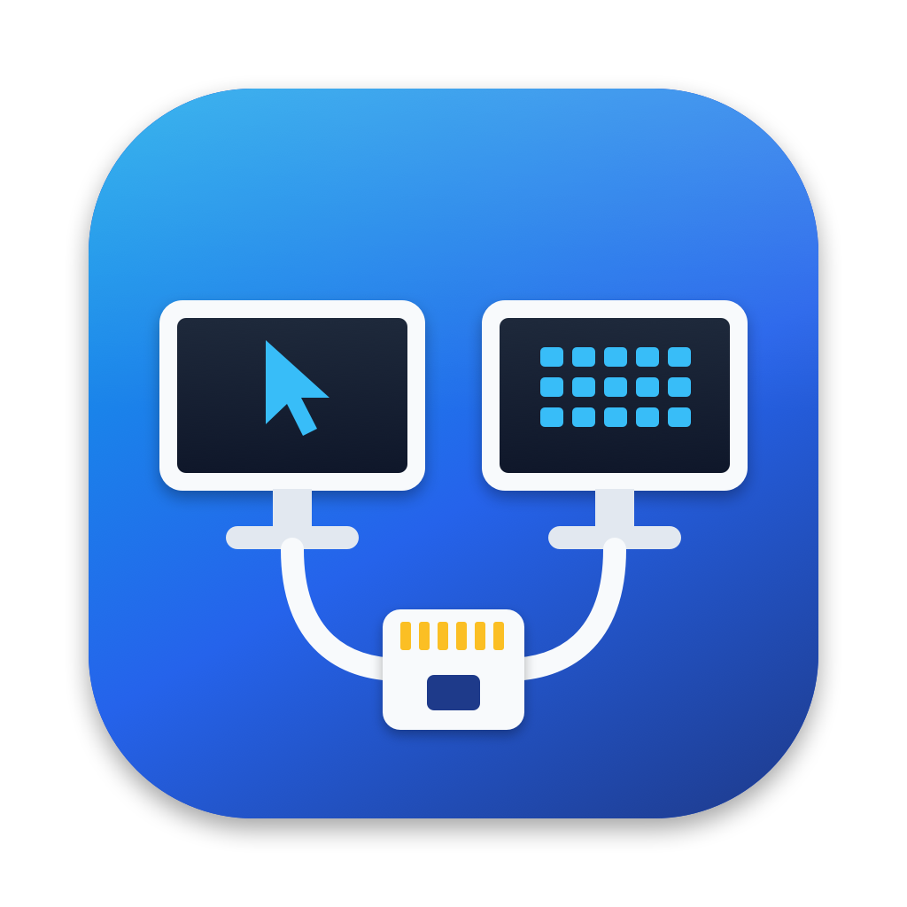

<p align="center"></p>

# EtherLink

**One keyboard and mouse for two Macs, over a direct Ethernet cable.**

EtherLink is a native macOS app that forwards keyboard and mouse input from one Mac to another over a cable you choose. Both Macs keep their own Wi-Fi and internet access. EtherLink never falls back to Wi-Fi, never changes routes or network settings, and only talks to the other Mac through the Ethernet adapter and address you select.

> **Status: working prototype (v0.4.3).** Shortcut and screen-edge switching, keyboard, mouse, dragging and scrolling work between two Macs. See [Limitations](#limitations).

## Why it exists

EtherLink was built for an **[LG 28MQ780-B DualUp](https://www.lg.com/ca_en/monitors/fhd-qhd/28mq780-b/)** monitor (27.6", 16:18, 2560×2880) showing two Macs side by side in Picture-by-Picture (PBP) mode, one over USB-C and one over HDMI, with the keyboard and mouse plugged into the monitor’s USB hub.

LG’s **Dual Controller** software is meant to let one keyboard and mouse control both computers in this kind of setup, but it did not work on these Macs. EtherLink replaces it with a small, dependable app that uses a direct Ethernet cable between the two Macs, so input sharing does not depend on LG’s software, the router or Wi-Fi.

The monitor is the reference setup, not a requirement. EtherLink works with any two Macs connected by Ethernet, on any displays.

## Features

- **Direct Ethernet only.** Listeners and connections are bound to the selected adapter and IPv4 address. Unplugging the cable drops the link; it never moves to Wi-Fi.
- **Encrypted pairing.** TLS 1.2 with a 256-bit pre-shared pairing key (AES-128-GCM), generated on one Mac and entered on the other. Keys can be saved in the Keychain.
- **Automatic reconnection** every five seconds over the selected adapter, after cable unplug, sleep or app restart.
- **Stays awake while in use.** macOS does not count forwarded input as activity, so the receiving Mac would sleep and lock while you use it. EtherLink keeps its display awake while you control it and, optionally, while you work at the keyboard Mac. A padlock in the menu bar shows when the other Mac is locked.
- **One coordinated keyboard source.** On first connection both Macs ask which one has the keyboard and mouse; answer on either screen and the pair agrees on exactly one source.
- **Screen-edge switching.** Push the pointer against the edge facing the other Mac to move there, at the matching height, and push against the facing edge on the other Mac to come back. On a Mac with several displays, only the edge of the display next to the other Mac switches: EtherLink picks the monitor both Macs are plugged into when it can, or you choose it. A brief brush, a pointer thrown at the menu bar or Dock, and the corners of the edge never switch.
- **Shortcut switching.** Control–Option–F8 by default (or record your own). **Control–Option–Escape** always returns control to the keyboard Mac.
- **Keyboard layouts just work.** Each key types the character it shows on the keyboard Mac, even if the other Mac uses a different layout (for example US and German), and shortcuts like ⌘Z follow the character.
- **Full input forwarding:** keys, modifiers, mouse movement, all buttons, dragging and two-axis scrolling, including trackpad momentum. You can type into password fields on the receiving Mac.
- **Safe failure.** If the link drops, local control returns immediately and any held keys or buttons are released. A heartbeat watchdog catches silent failures within five seconds.
- **Menu bar icon** with status, switching, sharing on/off and quit. Closing the window keeps EtherLink running.
- While you control the other Mac, the local pointer is hidden and held at the right-hand edge of the desktop so it does not wander across your displays. Hiding the pointer from a background app uses a window-server setting that is not part of the public macOS SDK; if a macOS version drops it, the pointer stays visible at that edge.

## Requirements

- Two Macs running **macOS 13 Ventura or later**, both logged in. Developed and tested on macOS 27 (Apple Silicon); Intel and older macOS versions are built for but untested.
- An Ethernet connection between the Macs (a direct cable or USB/Thunderbolt Ethernet adapters), with a manually assigned IPv4 address on each side, for example `192.168.50.1` and `192.168.50.2` with subnet mask `255.255.255.0` and no router.

## Install

1. Download `EtherLink.dmg` from the [latest release](../../releases/latest) on **both** Macs.
2. Open it, drag **EtherLink** to Applications, and open it from Applications.
3. The app is signed with a self-signed certificate and is **not notarized by Apple**, so macOS will block the first launch. Go to **System Settings → Privacy & Security** and click **Open Anyway**.

Install the same version on both Macs.

## Set up

1. **Choose the cable connection.** Select the Ethernet adapter on each Mac and enter the *other* Mac’s Ethernet IPv4 address.
2. Choose **Listen** on one Mac and **Connect** on the other.
3. **Pair.** Click **Generate key** on one Mac, transfer the key to the other Mac privately, and paste it there. Click **Save to Keychain** on both for automatic reconnection.
4. Click **Start listening**, then **Connect over Ethernet**. Choose **Allow** if macOS asks for Local Network access.
5. When asked **“Which Mac receives the keyboard and mouse?”**, answer on either Mac. If your keyboard and mouse are plugged into the monitor, pick the Mac currently receiving the monitor’s USB input.
6. Click **Enable sharing** on both Macs and grant **Accessibility** and **Input Monitoring** in System Settings → Privacy & Security. Reopen EtherLink if macOS asks.
7. On the keyboard Mac, set **Other Mac’s screen is** to the side where the other Mac’s screen sits. For two PBP halves side by side, choose **To the right** on the Mac shown on the left half. If that Mac has more than one display, check **Display next to the other Mac**: **Automatic** finds the monitor both Macs are plugged into, and otherwise you pick the display whose edge should switch. That edge must be an outer edge in System Settings → Displays (no other display arranged beyond it). **Push needed to switch** sets how firm the push is.
8. Push the pointer against that edge, and keep pushing for a moment, to control the other Mac, and against the facing edge there to come back. You can also press **Control–Option–F8**, and **Control–Option–Escape** always returns control to the keyboard Mac. Some keyboards also need **Fn** for function keys.

## Troubleshooting permissions

If EtherLink says it lacks Accessibility or Input Monitoring even though the toggles are on, macOS is holding a permission for a different copy of the app (for example an older version). Quit EtherLink, then run:

```sh
tccutil reset Accessibility local.EtherLink
tccutil reset ListenEvent local.EtherLink
```

Add `/Applications/EtherLink.app` again under both **Accessibility** and **Input Monitoring**, then reopen it. Delete any other EtherLink copies (Downloads, mounted disk images, the Trash) so System Settings cannot pick the wrong one. From v0.3.2, releases use a stable signing certificate, so permissions carry over to later updates.

If a Keychain prompt appears after an update, choose **Always Allow** so EtherLink can read its saved pairing key.

## Limitations

- **Screen edges:** one side and one display per Mac are configured per pair. Automatic display detection relies on both Macs reporting the same monitor identity, which a monitor may not do on every input; choose the display by hand if it does not. Top and bottom edges need a longer push than the sides. Crossing is blocked while a mouse button is held, so drags do not carry between Macs.
- **Keyboard layouts:** dead-key accents (such as Option-E then E on a US layout) are sent as the accent character and may not combine on the other Mac. Characters the other layout cannot type are sent as text, except with ⌘ or Control held.
- **Password fields on the keyboard Mac:** while one is focused (or Terminal’s *Secure Keyboard Entry* is on), macOS hides keystrokes from all apps, so control stays local until it ends. EtherLink tells you which app holds secure input. Typing into password fields on the receiving Mac works.
- **Login window, lock screen and FileVault:** not supported. macOS ignores synthetic input from apps there, and FileVault unlocks before any app runs, so use that Mac’s own keyboard, Touch ID or Apple Watch. EtherLink tells you when the other Mac is locked. To avoid getting locked out, leave **Keep this Mac awake while the keyboard Mac is in use** on, and consider a longer delay in System Settings → Lock Screen.
- Not notarized; the first launch needs **Open Anyway**.
- No clipboard sharing, file transfer or screen streaming.
- No latency measurements have been published.

## Build from source

Requires Xcode (the scripts use `/Applications/Xcode.app` without changing `xcode-select`; set `ETHERLINK_DEVELOPER_DIR` to override).

```sh
./scripts/check.sh                                   # protocol and state checks (15 groups)
.build/debug/EtherLink --layout-check                # real keyboard layouts on this Mac, plus German QWERTZ
./scripts/check.sh en0 192.168.50.1                  # plus two-process TLS tests on one Mac's Ethernet address
python3 scripts/test-role-pair.py en0 192.168.50.1   # keyboard-source negotiation over TLS
python3 scripts/test-ui-stall.py en0 192.168.50.1    # a blocked UI must not stall heartbeats
ETHERLINK_OUTPUT_DIR="$PWD/dist/local" ./scripts/build-dmg.sh
ETHERLINK_OUTPUT_DIR="$PWD/dist/local" ./scripts/verify-dmg.sh
```

`build-app.sh` signs with a keychain identity named **EtherLink Local Signing** if you have one, so macOS permissions survive rebuilds; otherwise it signs ad hoc and warns you. Create your own self-signed code-signing certificate with that name (Keychain Access → Certificate Assistant → Create a Certificate, type *Code Signing*), or set `ETHERLINK_SIGN_IDENTITY`.

The icon is drawn in code: `swift scripts/make-icon.swift Resources/AppIcon-1024.png`, then rebuild `Resources/AppIcon.icns` with `iconutil`.

### Project layout

| Path | Contents |
|---|---|
| `Sources/LinkCore` | Platform-independent protocol, framing, input packets, role negotiation and shortcuts |
| `Sources/EtherLink` | SwiftUI app, Network.framework transport, Core Graphics capture and injection |
| `Tests/LinkCoreTests` | Standalone check executable (no XCTest needed) |
| `scripts` | Build, packaging, icon and two-process test scripts |
| `docs` | Design notes and test record |

## Privacy

EtherLink sends input events only to the paired Mac over the selected Ethernet link. It never logs typed text or keystroke history, and it has no analytics or network access beyond that link.

## License

[MIT](LICENSE)
